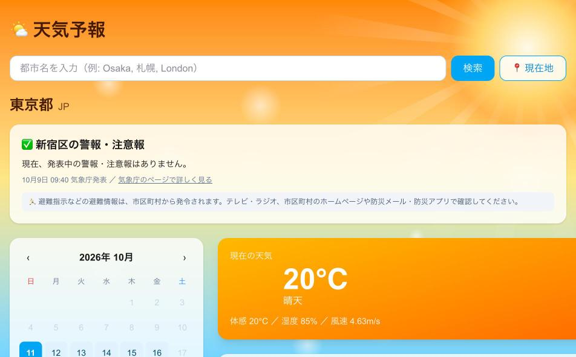
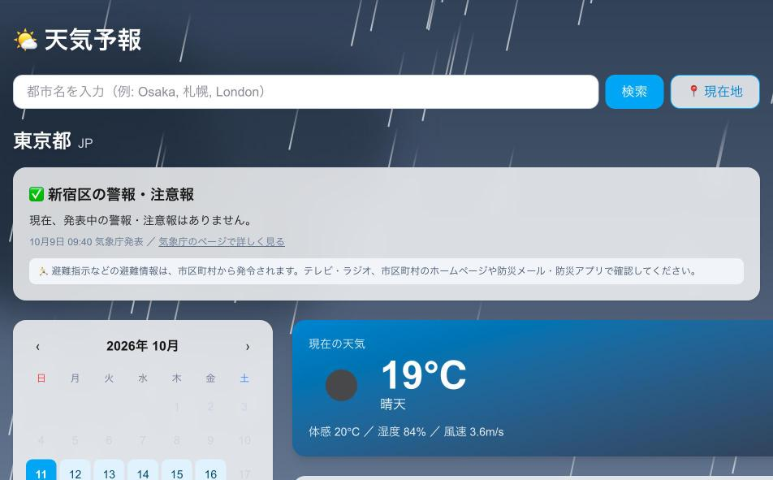
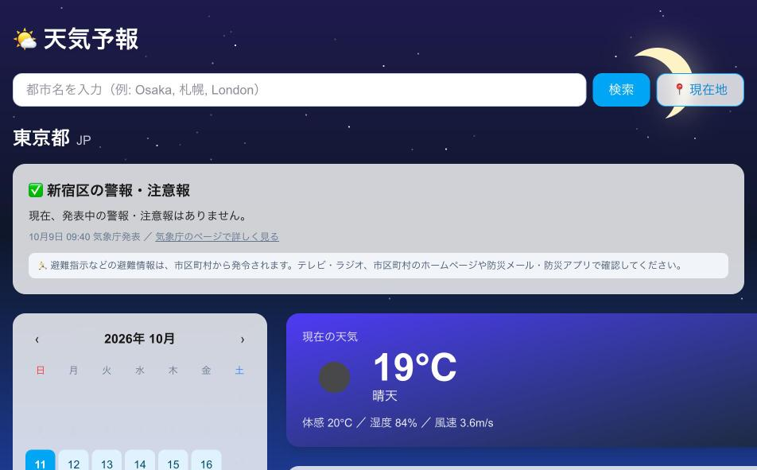

# 🌤 天気予報アプリ

## 画面

| 晴れ | 雨 | 夜 |
| --- | --- | --- |
|  |  |  |

## 技術スタック

| 技術 | 用途 |
| --- | --- |
| [Next.js](https://nextjs.org/) 16 | フレームワーク（画面と API） |
| [React](https://react.dev/) 19 | UI |
| [TypeScript](https://www.typescriptlang.org/) | 言語 |
| [Tailwind CSS](https://tailwindcss.com/) 4 | スタイリング |
| [OpenWeatherMap API](https://openweathermap.org/) | 天気データ |
| [気象庁](https://www.jma.go.jp/) / [国土地理院](https://www.gsi.go.jp/) | 警報・注意報、市区町村の判定 |
| [Vercel](https://vercel.com/) | ホスティング |
